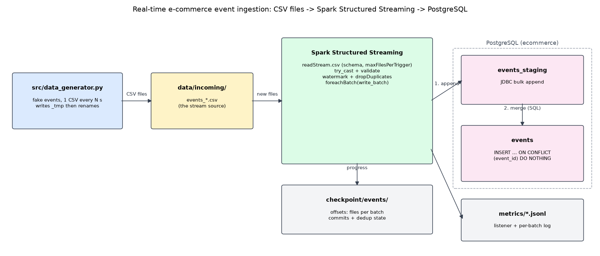

# Project Overview: Real-Time E-commerce Event Ingestion

A pipeline that simulates an online shop's user activity and loads it into
PostgreSQL as it happens. Fake events (product views, add-to-carts, purchases)
are written as CSV files. Spark Structured Streaming picks up each new file
within seconds, cleans it, and writes the rows into a PostgreSQL table.



## Components

| Component | File | Role |
|---|---|---|
| Event generator | `src/data_generator.py` (run as `python data_generator.py`) | Writes a CSV of fake events every few seconds into `data/incoming/`. A set share of rows is deliberately broken so the cleaning can be tested |
| Streaming job | `src/cleaning.py`, `src/postgres_sink.py`, `src/main.py` (run as `python spark_streaming_to_postgres.py`) | Watches the folder, reads each new file once, casts and validates every row, drops duplicates, and writes each micro-batch to PostgreSQL |
| Database | `postgres_setup.sql` | Creates the `ecommerce` database, the `spark_app` login, the `events` table and its `events_staging` landing table |
| Checkpoint | `checkpoint/events/` | Spark's memory: which files each batch read, which batches finished, and the deduplication state. Lets the job restart where it stopped |
| Metrics | `metrics/*.jsonl`, `src/perf_report.py` | Spark's progress report per batch, a per-batch write log, and a latency summary from the database |

## Data flow

1. **Generate.** The generator builds 100 events (by default). Each has a
   UUID `event_id`, a UTC timestamp with milliseconds, a user, a product, a
   category and a price. It writes them to `_events_<time>.csv`, then renames
   the file to `events_<time>.csv`. Spark ignores names starting with `_`,
   so it never sees a half-written file.
2. **Detect.** Every 5 seconds (the trigger), Spark lists the folder and takes
   up to `MAX_FILES` new files as one micro-batch.
3. **Clean.** Every column is read as text and then converted with `try_cast`,
   so a bad value becomes null instead of crashing the batch. A row is kept
   only if it has an id and a valid time, a positive user and product id,
   a known event type and a price ≥ 0.
4. **De-duplicate.** Rows with an `event_id` already seen in the last 10
   minutes of event time are dropped (`withWatermark` + `dropDuplicates`).
5. **Write.** For each micro-batch, `foreachBatch` appends the rows to
   `events_staging` over JDBC. One SQL statement then copies them into
   `events` with `ON CONFLICT (event_id) DO NOTHING` and empties the staging table.
6. **Commit.** Only after the write succeeds does Spark record the batch as
   done in the checkpoint.

## Table

```sql
events (
  event_id    TEXT PRIMARY KEY,
  event_time  TIMESTAMPTZ NOT NULL,
  user_id     INT NOT NULL CHECK (user_id > 0),
  session_id  TEXT,
  event_type  TEXT NOT NULL CHECK (event_type IN ('view','add_to_cart','purchase')),
  product_id  INT NOT NULL CHECK (product_id > 0),
  category    TEXT,
  price       NUMERIC(10,2) NOT NULL CHECK (price >= 0),
  quantity    INT CHECK (quantity >= 0),
  ingested_at TIMESTAMPTZ NOT NULL DEFAULT now()
)
```

## Design decisions

| Decision | Why |
|---|---|
| Read as strings, then `try_cast` | One bad value nulls one field and fails one row's checks. It does not fail the file. Spark 4 runs in ANSI mode, where a plain `cast` throws |
| Staging table + `ON CONFLICT DO NOTHING` | Spark delivers each batch *at least once*: after a crash it re-runs the last unfinished batch. Keying on `event_id` makes a re-run insert nothing twice. Tested: a forced replay of 83 rows inserted 0 |
| Watermark + `dropDuplicates` | Catches the same event arriving twice (e.g. a re-sent file) before it reaches the database. The watermark lets Spark forget old ids, so memory stays bounded |
| `TIMESTAMPTZ` columns | Stores an absolute instant. With plain `TIMESTAMP`, the JDBC driver wrote times in the laptop's zone (UTC+2), so every event looked 2 hours late |
| `ingested_at DEFAULT now()` | The database stamps arrival time, so end-to-end latency is `ingested_at − event_time` with no extra code |
| Rules in Spark *and* `CHECK` constraints in PostgreSQL | Spark filters bad rows. The constraints stop anything that slips past. Testing found exactly that case: `user_id = -5` passed a not-null check |
| Dedicated `spark_app` role | The job can insert events and empty its staging table, nothing else. The password lives only in `.env` |
| Settings from `.env` | The same code runs against another database, folder or trigger without edits |

## Results

- **Correctness:** with 20% of rows deliberately broken, exactly the expected
  1,615 of 2,000 rows arrived, and none broke a rule. Restarts, a hard kill,
  a duplicated file, a forced batch replay and an unreachable database all
  ended with the expected row count and no duplicates. See [test_cases.md](test_cases.md).
- **Performance:** at 50 rows/s with 5 files per batch, p50 latency was 5.4 s.
  At 1,000 rows/s with 10 files per batch and a 10 s trigger, 2,495 rows/s
  were processed. With only 1 file per batch, the job falls behind. See
  [performance_metrics.md](performance_metrics.md).

## Limitations and next steps

- Rejected rows are dropped without a record. A production version would
  write them to a `events_rejected` table (a "dead-letter" table) with the reason.
- A folder of CSV files stands in for a message queue. Kafka would be the
  usual source in production, and Spark's code would change only in `readStream`.
- The staging table assumes one writer. Two jobs at once would need a staging
  table per job, or a batch-id column.
- Everything was measured on one laptop.
